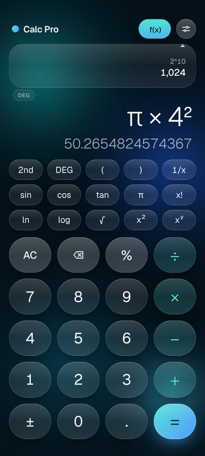
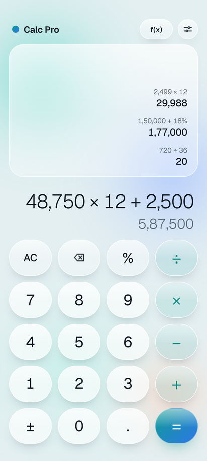

# Calc Pro

A liquid glass scientific calculator for Android, built with React Native 0.87 (New Architecture, Hermes).

<p>
  
  
</p>

## Design

- **Liquid glass**: frosted glass keys and panels float over slowly drifting pools of colored light.
- **Liquid fill**: the operator you just chose (and the 2nd and f(x) switches) fills with liquid that rises with a wave and drains away when you type the next number.
- **Spring motion**: keys squeeze on a spring and light up from the exact point you touch; results spring into place, history rows slide in and the settings sheet springs up. Every animation runs on the native UI thread, so it stays smooth while you type. The system "Remove animations" setting turns them off.
- **Four color themes**: Lagoon, Ember, Orchid and Graphite, each in light and dark, plus System/Light/Dark appearance.
- Typeface: Geist, with tabular numbers so digits don't jump while you type.

## Features

- **Live result** while you type, with correct operator precedence and parentheses (missing closing brackets are added for you).
- **History**: every result is saved. Tap a line to reuse its result, long-press to copy it. History, settings and your current input survive app restarts.
- **Scientific keys** (tap `f(x)`, or rotate the phone): sin, cos, tan and inverses, ln, log, eˣ, 10ˣ, √, ∛, x², x³, xʸ, x!, 1/x, π, e, degrees or radians.
- **Desk-calculator percent**: `200 + 10%` = 220, `200 − 10%` = 180, `200 × 10%` = 20.
- **Clean numbers**: no floating-point noise (`0.1 + 0.2` = 0.3, `1 ÷ 3 × 3` = 1), up to 15 significant digits, ×10ⁿ notation for very large and very small values.
- **Number formats**: international (1,234,567), Indian (12,34,567, the default on Indian locales) or plain.
- **Gestures**: swipe sideways on the number to delete the last digit, long-press ⌫ to clear everything, long-press the number to copy it.
- Clear error messages ("Can't divide by zero") that keep your expression for editing.
- Keyboard-style haptics, TalkBack labels for every key, layouts for small phones, large phones, tablets and landscape.
- No permissions besides vibration, no network access, no ads or tracking.

## Get the APK

### Option A: let GitHub build it (works from a phone, no PC needed)

1. Put this project in a GitHub repository (keep the `.github` and `scripts` folders).
2. GitHub Actions builds the APK on every push to the `calcpro` or `main` branch (or open **Actions → Build APK → Run workflow**). It takes about 20 minutes, including a smoke test on an Android emulator.
3. Open the repository's **calcpro-builds** branch and download `CalcPro.apk`. The `smoke` folder next to it has emulator screenshots, a short screen recording and the log.

### Option B: build on a computer

Requirements: Node.js 22+, JDK 17, and the Android SDK (installing Android Studio covers the SDK).

```sh
npm install
cd android
./gradlew assembleRelease        # Windows: gradlew.bat assembleRelease
```

The APK is written to `android/app/build/outputs/apk/release/app-release.apk`.

To run it on a connected phone during development: `npm start`, then `npm run android`.

### Installing on a phone

Open the downloaded `.apk` and allow installing from that source when Android asks. The APK contains both 64-bit and 32-bit ARM code, so it runs on practically every Android phone from Android 7.0 up.

## Signing with your own key

Without extra setup the release APK is signed with the standard React Native debug key, which is fine for installing it yourself. To publish (or keep a stable identity across builds), create a key once:

```sh
keytool -genkeypair -v -storetype PKCS12 -keystore calcpro-release.keystore \
  -alias calcpro -keyalg RSA -keysize 2048 -validity 10000
```

Then either:

- **Local builds:** add these lines to `~/.gradle/gradle.properties` (not to the project):
  ```properties
  CALCPRO_UPLOAD_STORE_FILE=/full/path/to/calcpro-release.keystore
  CALCPRO_UPLOAD_STORE_PASSWORD=...
  CALCPRO_UPLOAD_KEY_ALIAS=calcpro
  CALCPRO_UPLOAD_KEY_PASSWORD=...
  ```
- **GitHub builds:** add repository secrets `CALCPRO_KEYSTORE_BASE64` (output of `base64 -w0 calcpro-release.keystore`), `CALCPRO_KEYSTORE_PASSWORD`, `CALCPRO_KEY_ALIAS` and `CALCPRO_KEY_PASSWORD`.

Keep the keystore and passwords safe: Android only accepts updates signed with the same key. An APK signed with your key cannot be installed over one signed with the debug key; uninstall the old one first.

## Project layout

```
src/
  engine/        Calculator core (pure TypeScript, no React Native)
    tokens.ts      Token model for keyed-in input
    evaluate.ts    Recursive-descent evaluator (precedence, %, implicit ×)
    input.ts       Key handling rules as pure state transitions
    format.ts      Precision control and number formatting
    math.ts        Gamma/factorial, exact trig at multiples of 90°
  components/
    LiquidBackground.tsx  Drifting color pools (native-driver loops)
    Key.tsx               Glass key: spring press, touch light, liquid fill
    LiquidFill.tsx        Rising liquid with a wave crest and inverted label
    Display.tsx           Expression, live result, swipe and copy gestures
    History.tsx           Glass history card
    SettingsSheet.tsx     Color themes, appearance, formats, haptics
    GlassButton.tsx, Segmented.tsx, Toast.tsx, TopBar.tsx, Keypad.tsx
  state/         Reducer, settings, keypad definition, storage + haptics
  specs/         Turbo Native Module spec (codegen input)
  theme/         Color themes, fonts, text measurement
assets/liquid/   Light-pool and wave images (tinted at runtime)
android/app/src/main/java/com/calcpro/app/
  CalcKitModule.kt   Native storage (SharedPreferences) and haptics
  CalcKitPackage.kt  Module registration
  MainApplication.kt Applies the saved light/dark choice before launch
  MainActivity.kt    Paints the window in the chosen theme's color
__tests__/engine.test.ts  124 engine tests
```

## Scripts

| Command | What it does |
| --- | --- |
| `npm test` | Runs the engine test suite |
| `npm run typecheck` | Type-checks the project |
| `npm run lint` | Lints the project |
| `npm run apk` | Builds the release APK |

## Credits

Font: [Geist](https://github.com/vercel/geist-font) by Vercel, licensed under the SIL Open Font License 1.1 (see `licenses/Geist-OFL.txt`).
