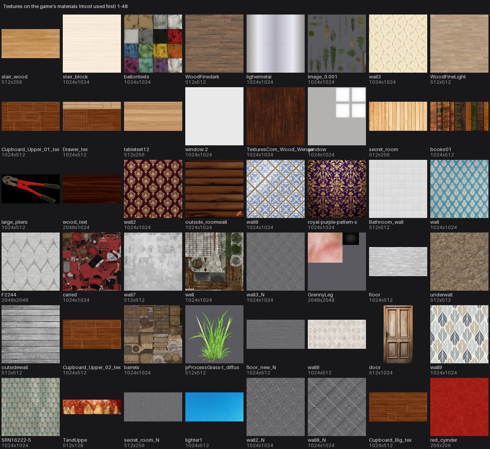
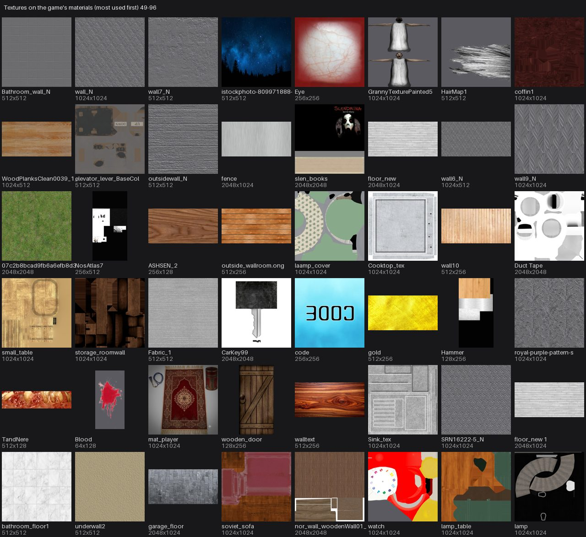
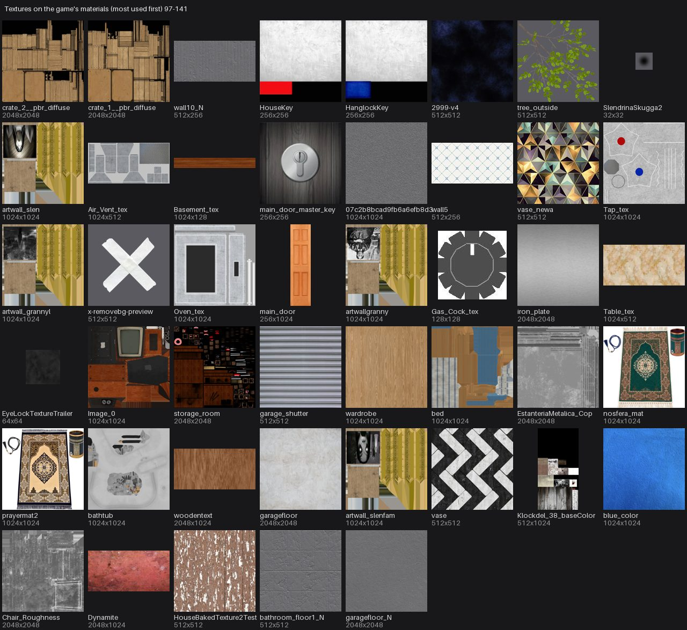
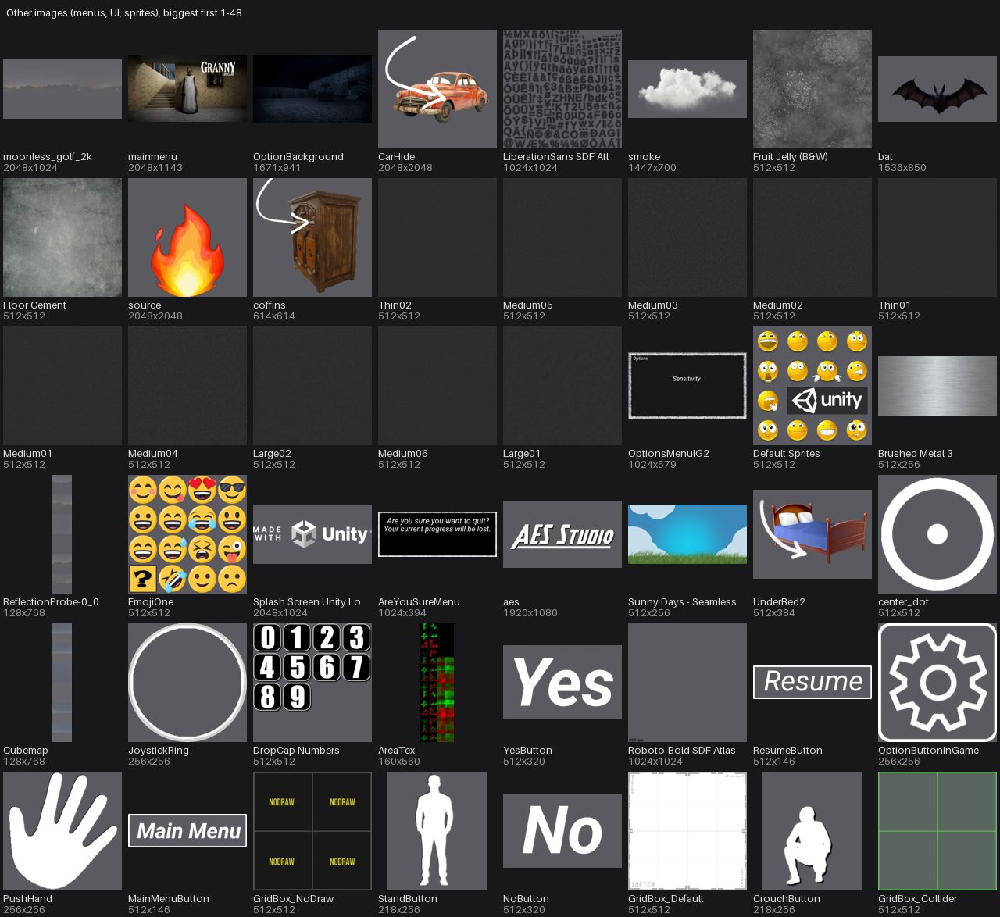
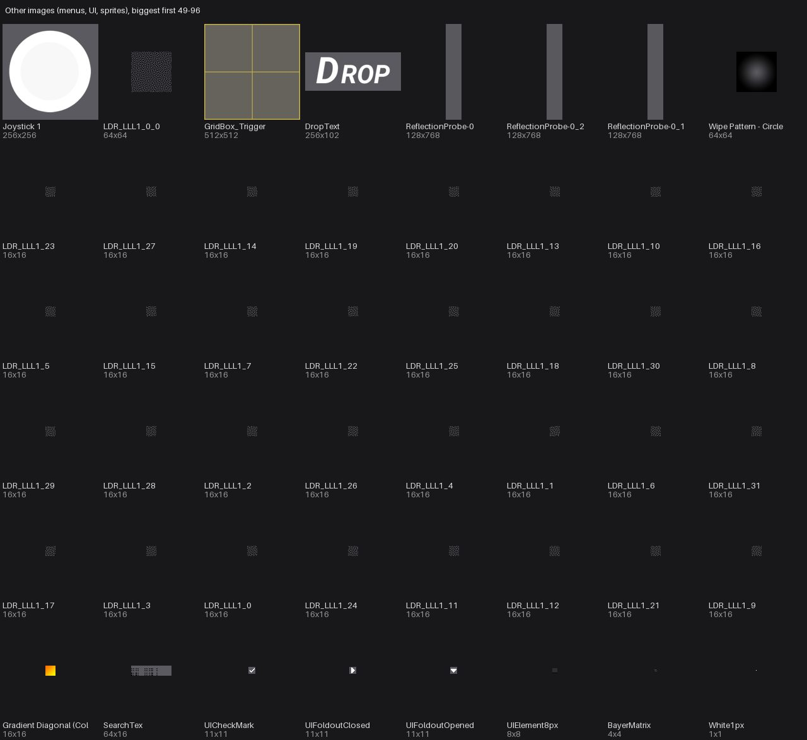

# Granny 4 End Game - what is inside

**Game Jolt:** Granny 4 EndGame by AES_Studio (https://gamejolt.com/@AES_Studio) - https://gamejolt.com/games/granny4endgame/1117042
**File:** granny-4-endgame.apk (version 1.0.0)

## APK

| | |
|---|---|
| label | Granny 4 EndGame |
| package | com.AESStudio.Granny4EndGame |
| versionName | 1 |
| versionCode | 1 |
| minSdk | 22 |
| targetSdk | 36 |
| abis | arm64-v8a armeabi-v7a |
| backend | IL2CPP |
| unity_version | 2022.3.62f3 |
| exported project | m_EditorVersion: 2022.3.62f3 |

**Player settings:** productName=Granny 4 EndGame, companyName=AES Studio, bundleVersion=1, defaultScreenOrientation=4, m_ActiveColorSpace=1, AndroidMinSdkVersion=0, AndroidTargetSdkVersion=0, applicationIdentifier={}, scriptingBackend={}, m_StereoRenderingPath=0, defaultScreenWidth=1920, defaultScreenHeight=1080, m_RenderingPath=0, m_MobileRenderingPath=0, AndroidTargetArchitectures=0

**Packages:** com.unity.modules.ai, com.unity.modules.androidjni, com.unity.modules.animation, com.unity.modules.assetbundle, com.unity.modules.audio, com.unity.modules.cloth, com.unity.modules.director, com.unity.modules.imageconversion, com.unity.modules.imgui, com.unity.modules.jsonserialize, com.unity.modules.particlesystem, com.unity.modules.physics, com.unity.modules.physics2d, com.unity.modules.screencapture, com.unity.modules.terrain, com.unity.modules.terrainphysics, com.unity.modules.tilemap, com.unity.modules.ui, com.unity.modules.uielements, com.unity.modules.umbra, com.unity.modules.unityanalytics, com.unity.modules.unitywebrequest, com.unity.modules.unitywebrequestassetbundle, com.unity.modules.unitywebrequestaudio, com.unity.modules.unitywebrequesttexture, com.unity.modules.unitywebrequestwww, com.unity.modules.vehicles, com.unity.modules.video, com.unity.modules.vr, com.unity.modules.wind, com.unity.modules.xr

## Scenes

| build # | scene | objects | meshes | lights |
|---|---|---|---|---|
| 0 | MainMenu | 62 | 0 | 1 |
| 1 | Main **(house)** | 1276 | 685 | 36 |
| 2 | EscapeCutScene | 341 | 96 | 6 |
| 3 | Scene_BalloonEscape | 231 | 71 | 3 |
| 4 | GameOverScene | 196 | 31 | 4 |

## Scene: EscapeCutScene

- fog: True (mode 2, colour [0.0, 0.0, 0.0, 1.0], density 0.17, linear 0-300)
- ambient: mode 0, sky [0.212, 0.227, 0.259, 1.0], equator [0.114, 0.125, 0.133, 1.0], ground [0.047, 0.043, 0.035, 1.0], intensity 0.2, skybox Night
- layout (5-95% of mesh positions): x -42.2..23.8, y 1.1..17.8, z -69.0..-43.4 (metres)
- 93 active meshes, 0 use baked lightmaps
- lights: 6 point
  - point `Directional Light (3)` colour [1.0, 1.0, 1.0] intensity 1.5 range 10 shadows 2 at [-3.0, 4.96, -53.66]
  - point `Directional LightGRANNY` colour [1.0, 1.0, 1.0] intensity 1 range 2 shadows 2 at [-5.995, 5.151, -53.686]
  - point `Directional Light (1)` colour [1.0, 1.0, 1.0] intensity 50 range 20 shadows 2 at [-32.82, 10.66, -54.9]
  - point `Directional Light (2)` colour [1.0, 1.0, 1.0] intensity 50 range 20 shadows 2 at [-19.34, 10.44, -53.66]
  - point `Directional Light` colour [1.0, 1.0, 1.0] intensity 1.5 range 10 shadows 2 at [-8.743, 4.776, -53.66]
  - point `Directional Light MOON` colour [1.0, 1.0, 1.0] intensity 80 range 8.052368 shadows 2 at [-48.01, 33.56, -53.66]
- scripts on objects:
  - `UnityEngine.Rendering.Universal.UniversalAdditionalLightData` x6 (Directional Light, Directional Light (1), Directional Light (2), Directional Light (3), Directional Light MOON, Directional LightGRANNY)
  - `UnityEngine.UI.Text` x1 (YouEscaped)
  - `UnityEngine.Rendering.Universal.UniversalAdditionalCameraData` x1 (Cutscene_Camera)
  - `GrannyStyleEnding` x1 (Cutscene_Camera)
  - `UnityEngine.UI.GraphicRaycaster` x1 (Canvas)
  - `UnityEngine.UI.CanvasScaler` x1 (Canvas)
  - `UnityEngine.EventSystems.EventSystem` x1 (EventSystem)
  - `UnityEngine.EventSystems.StandaloneInputModule` x1 (EventSystem)
  - `UnityEngine.Rendering.Volume` x1 (Global Volume)
  - `UnityEngine.UI.Image` x1 (ScreenFadeOverlay)
- most common object names: Plane x7, grassAS-01 x7, Directional Light x4, Cube x3, Tree_Branches_02_Tree_Branches_02_0 x2, Cube.015 x2, Bip01 Neck x2, Bip01 R UpperArm x2, Bip01 L Foot x2, Bip01 L Thigh x2, Bip01 Spine1 x2, GrannyHeadPos x2, Bip01 R Calf x2, Bip01 R Clavicle x2, Bip01 R Toe01 x2, Bip01 L Forearm x2, Bip01 R Thigh x2, Bip01 L Hand x2, Bip01 R Hand x2, Bip01 R Toe0 x2, Bip01 Head x2, Bip01 R Finger0 x2, Bip01 R Foot x2, Bip01 L Toe0 x2, Bip01 L UpperArm x2, Bip01 R Toe02 x2, Bip01 L Toe01 x2, Bip01 Pelvis x2, Bip01 L Calf x2, Bip01 L Finger0 x2, Bip01 Spine2 x2, Bip01 L Toe02 x2, Bip01 R Forearm x2, Bip01 L Clavicle x2, Bip01 Spine3 x2, Bip01 Spine x2, Camera_Target_Position x1, Camera_Target_Position first x1, Directional LightGRANNY x1, YouEscaped x1
- top level: Plane (2), Camera_Target_Position, Camera_Target_Position first, Directional Light (3), Plane (4), Plane, Plane (5), Directional Light (1), Directional Light (2), Plane (1), Directional Light, Cutscene_Camera, Canvas, Directional Light MOON, EventSystem, Plane (3), Global Volume, grassAS-01 (3), grassAS-01 (1), grassAS-01, grassAS-01 (5), grassAS-01 (6), grassAS-01 (4), escapescene, grassAS-01 (2), Nosferatu, GrannyParent (merge), tree.003_4

## Scene: GameOverScene

- fog: True (mode 3, colour [0.0, 0.0, 0.0, 1.0], density 0.1, linear 0-300)
- ambient: mode 3, sky [0.176, 0.176, 0.196, 1.0], equator [0.481, 0.481, 0.481, 1.0], ground [0.594, 0.594, 0.594, 1.0], intensity 1, skybox Klockdel_38_baseColor
- layout (5-95% of mesh positions): x -24.9..-16.8, y 1.4..4.0, z -74.1..-66.3 (metres)
- 31 active meshes, 0 use baked lightmaps
- lights: 1 point, 1 directional, 2 area
  - point `Point Light` colour [1.0, 1.0, 1.0] intensity 3.7 range 0.89 shadows 0 at [29.159, -0.382, -71.554]
  - directional `Directional Light` colour [1.0, 0.957, 0.839] intensity 1 range 10 shadows 2 at [0.0, 3.0, 0.0]
  - area `Area Light Death` colour [1.0, 1.0, 1.0] intensity 1.33 range 10 shadows 2 at [-20.667, 3.96, -70.22]
  - area `Area Light` colour [1.0, 1.0, 1.0] intensity 1 range 0.63 shadows 2 at [-13.382, 0.188, -58.801]
- scripts on objects:
  - `UnityEngine.Rendering.Universal.UniversalAdditionalLightData` x4 (Area Light, Area Light Death, Directional Light, Point Light)
  - `DayManager` x1 (DayManager)
  - `UnityEngine.Rendering.Universal.UniversalAdditionalCameraData` x1 (Main Camera)
  - `UnityEngine.UI.GraphicRaycaster` x1 (Canvas)
  - `UnityEngine.UI.CanvasScaler` x1 (Canvas)
  - `UnityEngine.EventSystems.EventSystem` x1 (EventSystem)
  - `UnityEngine.EventSystems.StandaloneInputModule` x1 (EventSystem)
  - `TMPro.TextMeshProUGUI` x1 (Text (TMP))
  - `CoffinDoorInteractable` x1 (Coffin_Pivot)
  - `UnityEngine.UI.Image` x1 (Image)
  - `UnityEngine.Rendering.Volume` x1 (Global Volume)
  - `Unity.AI.Navigation.NavMeshSurface` x1 (GameObject)
  - `TimelineGameOverController` x1 (GameOverManager)
  - `GrannyAI` x1 (GrannyAI)
  - `SecretBookshelfDoor` x1 (Bookshelfdeath)
- most common object names: Cube x2, Bip01 Neck x2, Bip01 R UpperArm x2, Bip01 L Foot x2, Bip01 L Thigh x2, Bip01 Spine1 x2, GrannyHeadPos x2, Bip01 R Calf x2, Bip01 R Clavicle x2, Bip01 R Toe01 x2, Bip01 L Forearm x2, Bip01 R Thigh x2, Bip01 L Hand x2, Bip01 R Hand x2, Bip01 R Toe0 x2, Bip01 Head x2, Bip01 R Finger0 x2, Bip01 R Foot x2, Bip01 L Toe0 x2, Bip01 L UpperArm x2, Bip01 R Toe02 x2, Bip01 L Toe01 x2, Window_Frame_Window_Painted_0 x2, Bip01 Pelvis x2, Bip01 L Calf x2, Bip01 L Finger0 x2, death3 x2, Glass_Glass01_0 x2, Bip01 Spine2 x2, Bip01 L Toe02 x2, Bip01 R Forearm x2, Bip01 L Clavicle x2, Bip01 Spine3 x2, Bip01 Spine x2, 30ea91b808664b0c9a7182671320c26b.fbx x2, Window_Frame x2, Glass x2, RootNode x2, Point Light x1, area lights x1
- top level: Point Light, area lights, BatJumpscareSystem, DayManager, Directional Light, Main Camera, Canvas, EventSystem, Coffin_Pivot, Global Volume, GameObject, GameOverManager, Area Light, GrannyAI, Bookshelfdeath, GrannyHouse1.99, Base_base_wood_0

## Scene: Main

- fog: True (mode 3, colour [0.0, 0.0, 0.0, 1.0], density 0.2, linear 0-300)
- ambient: mode 3, sky [0.176, 0.176, 0.196, 1.0], equator [0.481, 0.481, 0.481, 1.0], ground [0.594, 0.594, 0.594, 1.0], intensity 1, skybox bed_c_D2 1
- layout (5-95% of mesh positions): x -24.7..17.7, y -2.5..3.0, z -77.6..-46.3 (metres)
- 674 active meshes, 0 use baked lightmaps
- lights: 1 point, 26 area, 9 directional
  - point `Point Light` colour [1.0, 1.0, 1.0] intensity 3.7 range 0.89 shadows 0 at [29.159, -0.382, -71.554]
  - area `Area Light (22)` colour [1.0, 1.0, 1.0] intensity 1 range 10 shadows 2 at [-14.041, -1.13, -68.158]
  - area `Area Light (19)` colour [1.0, 1.0, 1.0] intensity 1 range 10 shadows 2 at [17.46, 1.23, -64.76]
  - directional `Spot Light upper ground` colour [0.9, 0.9, 0.9] intensity 0.1 range 5 shadows 0 at [-9.075, 0.136, -67.83]
  - area `Area Light (16)` colour [1.0, 1.0, 1.0] intensity 1 range 10 shadows 2 at [-7.49, 1.36, -55.5]
  - area `Area Light (20)` colour [1.0, 1.0, 1.0] intensity 1 range 10 shadows 2 at [-13.92, 3.92, -43.529]
  - area `Area Light (24)` colour [1.0, 1.0, 1.0] intensity 2 range 10 shadows 2 at [27.31, 0.169, -72.79]
  - area `Area Light (18)` colour [1.0, 1.0, 1.0] intensity 1 range 10 shadows 2 at [-17.324, 1.36, -63.35]
  - area `Area Light (21)` colour [1.0, 1.0, 1.0] intensity 1 range 10 shadows 2 at [-14.32, -1.13, -73.99]
  - area `Area Light (17)` colour [1.0, 1.0, 1.0] intensity 1 range 10 shadows 2 at [2.04, 1.36, -63.46]
  - directional `Spot Light (3)` colour [1.0, 1.0, 1.0] intensity 0.2 range 5 shadows 0 at [-18.073, 0.512, -67.5]
  - directional `Directional Light` colour [1.0, 1.0, 1.0] intensity 1 range 10 shadows 2 at [0.0, 3.0, 0.0]
- scripts on objects:
  - `InteractableItem` x38 (CarKey, CarKey (1), CarKey (2), Chain Cutter, Chain Cutter (1), Chain Cutter (2))
  - `UnityEngine.Rendering.Universal.UniversalAdditionalLightData` x36 (Area Light, Area Light (1), Area Light (10), Area Light (11), Area Light (12), Area Light (13))
  - `DoorInteractable` x28 (Door_Pivot-bathroom_door, Door_Pivot-bedroom1_door, Door_Pivot-bedroom2_door, Door_Pivot-bedrrom_door, Door_Pivot-nosfera_room_door, Door_Pivot-outside_door)
  - `UnityEngine.UI.Image` x26 (?, Background, BlackFadePanel, BlackScreen, Checkmark, CloseSettingsButton)
  - `ItemSway` x14 (Car Key_HoldPoint, Chain Cutter_HoldPoint, Cylinder_HoldPoint, Duct Tape_Hold Point, Gold Key_HoldPoint, Hammer_HoldPoint)
  - `UnityEngine.UI.Button` x11 (?, CloseSettingsButton, CrouchButton, HideButton, HideButtonCar, HideButtonCoffin)
  - `CreakingFloor` x11 (Cube, Cube (1), Cube (10), Cube (2), Cube (3), Cube (4))
  - `DrawerInteractable` x8 (Esfera.001, Esfera.002)
  - `HidingSpotDistanceTracker` x7 (Cabinet_empty, TriggerZone, bed (1), bed (2), cargranny, playerbed)
  - `EscapeLockElement` x6 (Chain, Master Key, Padlock, PadlockCode, Place Here, Plank)
  - `UnityEngine.UI.GraphicRaycaster` x5 (Canvas, DeathCanvas, FadeCanvas, FadeScreen, MobileControlsCanvas)
  - `UnityEngine.UI.CanvasScaler` x5 (Canvas, DeathCanvas, FadeCanvas, FadeScreen, MobileControlsCanvas)
  - `GrannyPatrolWaypoint` x5 (BedRoomLeft Point, BedRoomRight Point, InnerNosferaRoom Point, PlayerBedRoom Point, SecretBookRoom Point)
  - `HidingSpot` x5 (Cabinet_empty, bed (1), bed (2), cargranny, playerbed)
  - `UnityEngine.Rendering.Universal.UniversalAdditionalCameraData` x4 (CrashCutsceneCamera, CutSceneCamera, HeldItemCamera, Main Camera)
  - `PhysicsPropHolder` x4 (Painting_Holder, Painting_Holder (1), Painting_Holder (2), Painting_Holder (3))
  - `DistractionObject` x4 (Chair_low (5), Object_2, lamp (1), table_hightop)
  - `UnityEngine.UI.Text` x3 (ItemNameText, LockedNotificationText, Warning Text Display)
  - `FallingLockSound` x3 (Chain, Padlock, PadlockCode)
  - `ItemSpawnPoint` x2 (SpawnPoint_Bedroom_Table, SpawnPoint_Garage_Shelf)
  - `TMPro.TextMeshProUGUI` x2 (Day 1, Music)
  - `script:0` x2 (Chain Static, Chain Static (1))
  - `SilentGroundZone` x1 (SilentGround_Outside)
  - `SmoothRope` x1 (Dynamic_Rope)
  - `RopeAnchorInteraction` x1 (Anchor_WoodenBlock)
  - `SafeArea` x1 (SafeArea)
  - `PlayerHidingController` x1 (Player)
  - `FPSController` x1 (Player)
  - `MobileCrouchController` x1 (Player)
  - `PlayerPushPhysics` x1 (Player)
  - `PlayerInteractionEngine` x1 (Player)
  - `MobilePickUpScript` x1 (Player)
  - `PlayerWakeUp` x1 (Player)
  - `DayManager` x1 (DayManager)
  - `BalloonCylinderSlot` x1 (Interaction_CylinderSlot)
  - `PlankLockedDoorInteractable` x1 (Door_Pivot-nosfera_room_door (1))
  - `DoorPlankComponent` x1 (doorlockplank)
  - `GameManager` x1 (GameManagerSpeed)
  - `GameplayManager` x1 (GameplayManager)
  - `BalloonHoleZone` x1 (Interaction_BalloonHole)
  - `GameBackgroundOST` x1 (AmbientSoundManager)
  - `GameSettingsManager` x1 (SettingsManager)
  - `OutdoorAmbientZone` x1 (Outside_Audio_Zone)
  - `MainDoorEscape` x1 (Door_Pivot_main_door)
  - `ObjectPresetManager` x1 (ObjectPresetManager)
  - `ItemRespawnZone` x1 (RespawnZone_UnderFloor)
  - `EscapeSequenceManager` x1 (EscapeSequenceManager)
  - `UnityEngine.EventSystems.EventSystem` x1 (EventSystem)
  - `UnityEngine.EventSystems.StandaloneInputModule` x1 (EventSystem)
  - `JumpscareCoordinator` x1 (JumpscareManager)
  - `CoffinDoorInteractable` x1 (Coffin_Pivot)
  - `UnityEngine.UI.Toggle` x1 (MusicToggle)
  - `UnityEngine.Rendering.Volume` x1 (Global Volume)
  - `Unity.AI.Navigation.NavMeshSurface` x1 (GameObject)
  - `UnityEngine.UI.Slider` x1 (SensitivitySlider)
  - `BalloonBurnerZone` x1 (Interaction_BurnerUnit)
  - `AdsManager` x1 (UnityAdsManager)
  - `TripwireTrap` x1 (Doorbell_Tripwire)
  - `ItemPresetManager` x1 (ItemPresetManager)
  - `MobileJoystick` x1 (JoystickBackground)
- most common object names: Cube x44, GameObject x27, Area Light x26, door_block_2 x18, door_block x16, RootNode x16, door_block_upper x14, Cube.003 x12, Cube.001 x12, Cube.002 x11, window x10, Window_Frame_Window_Painted_0 x10, Glass_Glass01_0 x10, 30ea91b808664b0c9a7182671320c26b.fbx x10, Window_Frame x10, Glass x10, Cylinder x9, default x9, Door x8, Torus x6, crouch_place_wall x6, Object_4 x6, Object_2 x6, Cube.018 x5, Chair_low x5, Empty x5, Cube.004 x5, Seat_low x5, Backplanks_2_low x5, Object_5 x4, artframe x4, Cupboard_Upper_01_Door_L x4, Painting_Holder x4, Cupboard_Upper_01_Door_R x4, Spot Light x4, maindoorwall x4, TriggerZone x4, Object_3 x4, Drawer x4, Secret Book x4
- top level: SilentGround_Outside, BackYard Point, Point Light, Dynamic_Rope, Anchor_WoodenBlock, Player, area lights, Canvas, GrannyCrashRespawnPoint, Garage_DoorPivot, SpawnPoint_Garage_Shelf, Garage Point (1), Master Key, House Lights, LeverHandle, garage_cupboard, Door_Pivot-bedrrom_door, BatJumpscareSystem, GameObject, DayManager, BedRoomLeft Point, Door_Pivot-nosfera_room_door (1), BedRoomRight Point, Vase1, balloon (1), ItemRespawnPoint, KitchenRoom Point, Painting_Holder (2), Door_Pivot-bedroom2_door, Plank, LeverHandle 1, LibraryRoom Point, EscapeDoor Point, Directional Light, SecretBookRoom Point, bathroom_cupboard, Plane, GameManagerSpeed, PlayerBedRoom Point, nosfera_cupboard, GameplayManager, Mobile_Fire, Door_Pivot-secret_room_door, ItemSpawnPoint, Door_Pivot-bathroom_door, AmbientSoundManager, MobileControlsCanvas, Door_Pivot-nosfera_room_door, plankopen, Plane (1), Garage Point, PadlockCode, Door_Pivot-bedroom1_door, Painting_Holder (3), Door_Pivot-outside_door, WakeUpPoint, DeathCanvas, WakeUpPoint, SettingsManager, GrannySpawnPoint

## Scene: MainMenu

- fog: False (mode 3, colour [0.5, 0.5, 0.5, 1.0], density 0.01, linear 0-300)
- ambient: mode 0, sky [0.212, 0.227, 0.259, 1.0], equator [0.114, 0.125, 0.133, 1.0], ground [0.047, 0.043, 0.035, 1.0], intensity 1, skybox builtin:0
- lights: 1 directional
  - directional `Directional Light` colour [1.0, 0.957, 0.839] intensity 1 range 10 shadows 2 at [0.0, 3.0, 0.0]
- scripts on objects:
  - `UnityEngine.UI.Image` x27 (Arrow, Background, Button_Easy, Button_Extreme, Button_Hard, Button_Normal)
  - `TMPro.TextMeshProUGUI` x18 (DifficultyDescription, Item Label, Label, LoadingText, Quality, Text (TMP))
  - `UnityEngine.UI.Button` x9 (Button_Easy, Button_Extreme, Button_Hard, Button_Normal, Button_Practice, Continue)
  - `UnityEngine.UI.Toggle` x4 (Darker Mode Toggle, Item, Music Toggle, Toggle_ExtraLocks)
  - `UnityEngine.UI.Mask` x1 (Viewport)
  - `TMPro.TMP_Dropdown` x1 (Quality Dropdown)
  - `MainMenuManager` x1 (MainMenuManagerObject)
  - `UnityEngine.Rendering.Universal.UniversalAdditionalCameraData` x1 (Main Camera)
  - `UnityEngine.EventSystems.EventSystem` x1 (EventSystem)
  - `UnityEngine.EventSystems.StandaloneInputModule` x1 (EventSystem)
  - `UnityEngine.Rendering.Universal.UniversalAdditionalLightData` x1 (Directional Light)
  - `UnityEngine.UI.Scrollbar` x1 (Scrollbar)
  - `UnityEngine.UI.ScrollRect` x1 (Template)
  - `UnityEngine.UI.GraphicRaycaster` x1 (MainMenuCanvas)
  - `UnityEngine.UI.CanvasScaler` x1 (MainMenuCanvas)
- most common object names: Text (TMP) x13, Background x3, Checkmark x3, Continue x2, LoadingPanel x2, OptionBackground x1, Item Background x1, Toggle_ExtraLocks x1, Quality x1, Viewport x1, Item Label x1, Handle x1, MenuBackground x1, MainMenuPanel x1, Item Checkmark x1, DifficultyDescription x1, GoodLuckPanel x1, Image x1, Content x1, Quality Dropdown x1, OptionsChoosePanel x1, Button_Normal x1, Quit x1, MainMenuManagerObject x1, Main Camera x1, EventSystem x1, MenuBackgroundMusic x1, Play x1, Directional Light x1, Arrow x1, Button_Easy x1, Button_Extreme x1, Music Toggle x1, LoadingBackground x1, Darker Mode Toggle x1, Scrollbar x1, Item x1, Sliding Area x1, Label x1, Template x1
- top level: MainMenuManagerObject, Main Camera, EventSystem, MenuBackgroundMusic, Directional Light, MainMenuCanvas

## Scene: Scene_BalloonEscape

- fog: True (mode 3, colour [0.0, 0.0, 0.0, 1.0], density 0.15, linear 0-300)
- ambient: mode 3, sky [0.462, 0.462, 0.462, 1.0], equator [0.114, 0.125, 0.133, 1.0], ground [0.047, 0.043, 0.035, 1.0], intensity 1, skybox bed_c_D2 1
- layout (5-95% of mesh positions): x -2.7..27.3, y -1.8..0.8, z -74.2..-55.6 (metres)
- 69 active meshes, 0 use baked lightmaps
- lights: 2 area, 1 directional
  - area `Point Light` colour [1.0, 1.0, 1.0] intensity 1 range 10 shadows 2 at [17.46, 1.23, -64.76]
  - area `Point Light (1)` colour [1.0, 1.0, 1.0] intensity 1 range 10 shadows 2 at [2.04, 1.36, -63.46]
  - directional `Sun` colour [1.0, 1.0, 1.0] intensity 5.13 range 10 shadows 1 at [6.87, -0.56, -63.621]
- scripts on objects:
  - `UnityEngine.UI.Image` x24 (?, Background, BlackFadePanel, BlackScreen, Checkmark, CloseSettingsButton)
  - `UnityEngine.UI.Button` x10 (?, CloseSettingsButton, CrouchButton, HideButton, HideButtonCoffin, InteractButton)
  - `UnityEngine.UI.GraphicRaycaster` x5 (Canvas, DeathCanvas, FadeCanvas, MobileControlsCanvas)
  - `UnityEngine.UI.CanvasScaler` x5 (Canvas, DeathCanvas, FadeCanvas, MobileControlsCanvas)
  - `UnityEngine.UI.Text` x3 (ItemNameText, LockedNotificationText, Warning Text Display)
  - `TMPro.TextMeshProUGUI` x3 (Day 1, Music, Text (TMP))
  - `UnityEngine.Rendering.Universal.UniversalAdditionalCameraData` x3 (CutSceneCamera, PLAYERCAMERA, Vcam1)
  - `UnityEngine.Rendering.Universal.UniversalAdditionalLightData` x3 (Point Light, Point Light (1), Sun)
  - `DayManager` x1 (GameManager)
  - `BalloonCylinderSlot` x1 (Interaction_CylinderSlot)
  - `UnityEngine.Timeline.SignalReceiver` x1 (Anim)
  - `UnityEngine.Rendering.Volume` x1 (Global Volume)
  - `EscapeSceneController` x1 (EscapeController)
  - `DoorInteractable` x1 (Door_Pivot-outside_door)
  - `GameSettingsManager` x1 (SettingsManager)
  - `EscapeSequenceManager` x1 (EscapeSequenceManager)
  - `UnityEngine.EventSystems.EventSystem` x1 (EventSystem)
  - `UnityEngine.EventSystems.StandaloneInputModule` x1 (EventSystem)
  - `JumpscareCoordinator` x1 (JumpscareManager)
  - `UnityEngine.UI.Toggle` x1 (MusicToggle)
  - `Unity.AI.Navigation.NavMeshSurface` x1 (GameObject)
  - `UnityEngine.UI.Slider` x1 (SensitivitySlider)
  - `BalloonBurnerZone` x1 (Interaction_BurnerUnit)
  - `MobileJoystick` x1 (JoystickBackground)
  - `HotAirBalloonEscape` x1 (HotAirBalloon_Parent)
- most common object names: Cube x5, floorground x2, Background x2, Canvas x2, Object_4 x2, Point Light x2, barrel_big_Barrels_0 x2, Granny x2, GrannyHeadPos x2, RootNode x2, Doorshed x1, Warning Text Display x1, Object_5 x1, JoystickHandle x1, Text (TMP) x1, LockedNotificationText x1, Handle Slide Area x1, door_block_2 (16)shed x1, CloseSettingsButton x1, Cube.140 x1, Vcam1 x1, Crosshair x1, outsidefloor x1, Burner_Flame_Particles x1, GameManager x1, Interaction_CylinderSlot x1, Anim x1, CutSceneCamera x1, Setting x1, Cube.007 floor x1, Cube.144 x1, MainMenu x1, Handle x1, True x1, Fill Area x1, HideButtonCoffin x1, Fill x1, ItemNameText x1, door_block (16)shed x1, Day 1 x1
- top level: Canvas, Vcam1, Canvas, GameManager, Anim, Global Volume, AmbientSoundManager, MobileControlsCanvas, EscapeController, Door_Pivot-outside_door, DeathCanvas, Point Light, SettingsManager, EscapeAudio, Player, EscapeSequenceManager, Point Light (1), EventSystem, JumpscareManager, FadeCanvas, GameObject, Granny, HotAirBalloon_Parent, Wooden Bench (LPoly), well_water, GrannyHouse1.99, WoodenWall, barrels.fbx, crate_2, crate_1, Sun

## Materials

185 materials; most used:

- `stair_block` x53 - shader Universal Render Pipeline_Lit - texture stair_block.png - colour [1.0, 1.0, 1.0, 1.0]
- `ballontexts` x39 - shader Universal Render Pipeline_Unlit - texture ballontexts.png - colour [0.577, 0.577, 0.577, 1.0]
- `Lit` x38 - shader Universal Render Pipeline_Lit - texture - - colour [0.5, 0.5, 0.5, 1.0]
- `stair_wood` x38 - shader Universal Render Pipeline_Lit - texture stair_wood.png - colour [1.0, 1.0, 1.0, 1.0]
- `WoodFinedark` x37 - shader Universal Render Pipeline_Unlit - texture WoodFinedark.png - colour [1.0, 1.0, 1.0, 1.0]
- `Cupboard_Upper_01_tex` x37 - shader builtin:10752 - texture Cupboard_Upper_01_tex.png - colour [1.0, 1.0, 1.0, 1.0]
- `walltext` x36 - shader Universal Render Pipeline_Lit - texture stair_wood.png - colour [1.0, 1.0, 1.0, 1.0]
- `lighermetal` x35 - shader Universal Render Pipeline_Unlit - texture lighermetal.png - colour [0.679, 0.679, 0.679, 1.0]
- `Image_0.001` x20 - shader Universal Render Pipeline_Lit - texture Image_0.001.png - colour [1.0, 1.0, 1.0, 1.0]
- `the-rich-dark-grain-of-polished-rosewood-reveals-intricate-patterns-and-textures-creating-a-warm-and-sophisticated-surface-perfect-for-backgrounds-or-designs-photo` x20 - shader Universal Render Pipeline_Lit - texture stair_wood.png - colour [0.811, 0.811, 0.811, 1.0]
- `wall3` x19 - shader Universal Render Pipeline_Lit - texture wall3.png - colour [1.0, 1.0, 1.0, 1.0]
- `WoodFineLight` x19 - shader Universal Render Pipeline_Unlit - texture WoodFineLight.png - colour [0.858, 0.858, 0.858, 1.0]
- `Drawer_tex` x16 - shader Universal Render Pipeline_Unlit - texture Drawer_tex.png - colour [1.0, 1.0, 1.0, 1.0]
- `tabletext12` x15 - shader Universal Render Pipeline_Unlit - texture tabletext12.png - colour [0.67, 0.67, 0.67, 1.0]
- `window 2` x14 - shader Universal Render Pipeline_Unlit - texture window 2.png - colour [0.698, 0.698, 0.698, 1.0]
- `TexturesCom_Wood_Wenge_1K_albedo` x13 - shader Universal Render Pipeline_Unlit - texture TexturesCom_Wood_Wenge_1K_albedo.png - colour [1.0, 1.0, 1.0, 1.0]
- `window` x12 - shader Universal Render Pipeline_Unlit - texture window.png - colour [0.708, 0.708, 0.708, 1.0]
- `secret_room` x12 - shader Universal Render Pipeline_Lit - texture secret_room.png - colour [1.0, 1.0, 1.0, 1.0]
- `buttons` x12 - shader Universal Render Pipeline_Lit - texture - - colour [1.0, 1.0, 1.0, 1.0]
- `books01` x12 - shader Universal Render Pipeline_Unlit - texture books01.png - colour [0.802, 0.802, 0.802, 1.0]
- `large_pliers` x12 - shader Universal Render Pipeline_Unlit - texture large_pliers.png - colour [0.736, 0.736, 0.736, 1.0]
- `wood_text` x11 - shader Universal Render Pipeline_Lit - texture wood_text.png - colour [1.0, 1.0, 1.0, 1.0]
- `wall2` x11 - shader Universal Render Pipeline_Lit - texture wall2.png - colour [1.0, 1.0, 1.0, 1.0]
- `outside_roomwall` x11 - shader Universal Render Pipeline_Unlit - texture outside_roomwall.png - colour [1.0, 1.0, 1.0, 1.0]
- `wall8` x10 - shader Universal Render Pipeline_Lit - texture wall8.png - colour [1.0, 1.0, 1.0, 1.0]
- `Bathroom_wall` x10 - shader Universal Render Pipeline_Lit - texture Bathroom_wall.png - colour [1.0, 1.0, 1.0, 1.0]
- `Wall` x10 - shader Universal Render Pipeline_Lit - texture wall.png - colour [1.0, 1.0, 1.0, 1.0]
- `F2244` x10 - shader Universal Render Pipeline_Lit - texture F2244.png - colour [1.0, 1.0, 1.0, 1.0]
- `carred` x10 - shader Universal Render Pipeline_Unlit - texture carred.png - colour [0.764, 0.764, 0.764, 1.0]
- `wall7` x10 - shader Universal Render Pipeline_Lit - texture wall7.png - colour [1.0, 1.0, 1.0, 1.0]
- `numbers` x10 - shader Universal Render Pipeline_Lit - texture - - colour [1.0, 1.0, 1.0, 1.0]
- `well` x10 - shader Universal Render Pipeline_Lit - texture well.png - colour [1.0, 1.0, 1.0, 1.0]
- `Rocks` x8 - shader Universal Render Pipeline_Lit - texture - - colour [0.8, 0.8, 0.8, 1.0]
- `GrannyLeg` x8 - shader Universal Render Pipeline_Lit - texture GrannyLeg.png - colour [1.0, 1.0, 1.0, 1.0]
- `floor` x8 - shader Universal Render Pipeline_Lit - texture floor.png - colour [1.0, 1.0, 1.0, 1.0]
- `underwall` x8 - shader Universal Render Pipeline_Lit - texture underwall.png - colour [1.0, 1.0, 1.0, 1.0]
- `outsidewall` x8 - shader Universal Render Pipeline_Lit - texture outsidewall.png - colour [1.0, 1.0, 1.0, 1.0]
- `Cupboard_Upper_02_tex` x8 - shader Universal Render Pipeline_Unlit - texture Cupboard_Upper_02_tex.png - colour [1.0, 1.0, 1.0, 1.0]
- `barrels` x8 - shader Universal Render Pipeline_Unlit - texture barrels.png - colour [0.84, 0.84, 0.84, 1.0]
- `pProcessGrass-t_diffuseOriginal` x7 - shader Universal Render Pipeline_Lit - texture pProcessGrass-t_diffuseOriginal.png - colour [1.0, 1.0, 1.0, 1.0]

## Textures

## Code

Game scripts (110): Assembly-CSharp/AdsManager.cs, Assembly-CSharp/AntiClippingItem.cs, Assembly-CSharp/BalloonBurnerZone.cs, Assembly-CSharp/BalloonCylinderSlot.cs, Assembly-CSharp/BalloonHoleZone.cs, Assembly-CSharp/CabinetInteractable.cs, Assembly-CSharp/ChatController.cs, Assembly-CSharp/CoffinDoorInteractable.cs, Assembly-CSharp/CreakingFloor.cs, Assembly-CSharp/CutObjectPhysics.cs, Assembly-CSharp/DayManager.cs, Assembly-CSharp/DistractionObject.cs, Assembly-CSharp/DoorInteractable.cs, Assembly-CSharp/DoorLockComponent.cs, Assembly-CSharp/DoorPlankComponent.cs, Assembly-CSharp/DrawerInteractable.cs, Assembly-CSharp/DrawerPivotAnimation.cs, Assembly-CSharp/DropdownSample.cs, Assembly-CSharp/EnvMapAnimator.cs, Assembly-CSharp/EscapeItemController.cs, Assembly-CSharp/EscapeLockElement.cs, Assembly-CSharp/EscapeLockType.cs, Assembly-CSharp/EscapeSceneController.cs, Assembly-CSharp/EscapeSequenceManager.cs, Assembly-CSharp/ExtremeFenceLock.cs, Assembly-CSharp/FPSController.cs, Assembly-CSharp/FallingLockSound.cs, Assembly-CSharp/FallingPainting.cs, Assembly-CSharp/GameBackgroundOST.cs, Assembly-CSharp/GameManager.cs, Assembly-CSharp/GameQualityApplier.cs, Assembly-CSharp/GameSettingsManager.cs, Assembly-CSharp/GameplayManager.cs, Assembly-CSharp/GrannyAI.cs, Assembly-CSharp/GrannyDifficultySettings.cs, Assembly-CSharp/GrannyDrawer.cs, Assembly-CSharp/GrannyPatrolWaypoint.cs, Assembly-CSharp/GrannyStyleEnding.cs, Assembly-CSharp/HidingCameraLook.cs, Assembly-CSharp/HidingSpot.cs, Assembly-CSharp/HidingSpotDistanceTracker.cs, Assembly-CSharp/HidingTriggerZone.cs, Assembly-CSharp/HotAirBalloonEscape.cs, Assembly-CSharp/IInteractable.cs, Assembly-CSharp/InteractableItem.cs, Assembly-CSharp/ItemBedDropHelper.cs, Assembly-CSharp/ItemPresetManager.cs, Assembly-CSharp/ItemRespawnZone.cs, Assembly-CSharp/ItemSpawnPoint.cs, Assembly-CSharp/ItemSway.cs, Assembly-CSharp/JumpscareCoordinator.cs, Assembly-CSharp/JumpscareFadeOverlay.cs, Assembly-CSharp/LeverInteractable.cs, Assembly-CSharp/LockType.cs, Assembly-CSharp/MainDoorEscape.cs, Assembly-CSharp/MainMenuManager.cs, Assembly-CSharp/MobileCrouchController.cs, Assembly-CSharp/MobileJoystick.cs, Assembly-CSharp/MobilePickUpScript.cs, Assembly-CSharp/MusicSettings.cs, Assembly-CSharp/ObjectPresetManager.cs, Assembly-CSharp/OutdoorAmbientZone.cs, Assembly-CSharp/PhysicsPropHolder.cs, Assembly-CSharp/PlankLockedDoor.cs, Assembly-CSharp/PlankLockedDoorInteractable.cs, Assembly-CSharp/PlayerHidingController.cs, Assembly-CSharp/PlayerInteractionEngine.cs, Assembly-CSharp/PlayerPushPhysics.cs, Assembly-CSharp/PlayerWakeUp.cs, Assembly-CSharp/Properties/AssemblyInfo.cs, Assembly-CSharp/RopeAnchorInteraction.cs, Assembly-CSharp/SafeArea.cs, Assembly-CSharp/SecretBookshelfDoor.cs, Assembly-CSharp/SilentGroundZone.cs, Assembly-CSharp/SmoothRope.cs, Assembly-CSharp/TMPro/Examples/Benchmark01.cs, Assembly-CSharp/TMPro/Examples/Benchmark01_UGUI.cs, Assembly-CSharp/TMPro/Examples/Benchmark02.cs, Assembly-CSharp/TMPro/Examples/Benchmark03.cs, Assembly-CSharp/TMPro/Examples/Benchmark04.cs, Assembly-CSharp/TMPro/Examples/CameraController.cs, Assembly-CSharp/TMPro/Examples/ObjectSpin.cs, Assembly-CSharp/TMPro/Examples/ShaderPropAnimator.cs, Assembly-CSharp/TMPro/Examples/SimpleScript.cs, Assembly-CSharp/TMPro/Examples/SkewTextExample.cs, Assembly-CSharp/TMPro/Examples/TMP_ExampleScript_01.cs, Assembly-CSharp/TMPro/Examples/TMP_FrameRateCounter.cs, Assembly-CSharp/TMPro/Examples/TMP_TextEventCheck.cs, Assembly-CSharp/TMPro/Examples/TMP_TextInfoDebugTool.cs, Assembly-CSharp/TMPro/Examples/TMP_TextSelector_A.cs, Assembly-CSharp/TMPro/Examples/TMP_TextSelector_B.cs, Assembly-CSharp/TMPro/Examples/TMP_UiFrameRateCounter.cs, Assembly-CSharp/TMPro/Examples/TMPro_InstructionOverlay.cs, Assembly-CSharp/TMPro/Examples/TeleType.cs, Assembly-CSharp/TMPro/Examples/TextConsoleSimulator.cs, Assembly-CSharp/TMPro/Examples/TextMeshProFloatingText.cs, Assembly-CSharp/TMPro/Examples/TextMeshSpawner.cs, Assembly-CSharp/TMPro/Examples/VertexColorCycler.cs, Assembly-CSharp/TMPro/Examples/VertexJitter.cs, Assembly-CSharp/TMPro/Examples/VertexShakeA.cs, Assembly-CSharp/TMPro/Examples/VertexShakeB.cs, Assembly-CSharp/TMPro/Examples/VertexZoom.cs, Assembly-CSharp/TMPro/Examples/WarpTextExample.cs, Assembly-CSharp/TMPro/TMP_DigitValidator.cs, Assembly-CSharp/TMPro/TMP_PhoneNumberValidator.cs, Assembly-CSharp/TMPro/TMP_TextEventHandler.cs, Assembly-CSharp/TimelineGameOverController.cs, Assembly-CSharp/TripwireTrap.cs, Assembly-CSharp/UltimateEscapeEngine.cs, Assembly-CSharp/VideoGameOverController.cs

Other assemblies: 

## Sounds (63)

Bats2.ogg, BirdSeedRamlar.ogg, BodyFallsGrus.ogg, BordRamlar.ogg, BurdoorOpen.ogg, CabinetDoorOpen.ogg, CarTrunkClose.ogg, CarTrunkOpen.ogg, CodeplattaOnFloor.ogg, CuttingPlierFloor.ogg, DoorClock2.ogg, DoorLocked.ogg, DropHandwheel.ogg, DropToplock.ogg, DucttapeFloor.ogg, EndSceneSoundOutside (online-video-cutter.com) (1).ogg, FlyHelicopterMusic.ogg, Galge2.ogg, GameOverScene4Music_2.ogg, Granny2_InGameMusic1.ogg, GrannyJumpscare.ogg, GrannyJumpscare3.ogg, Granny_Menu.ogg, HammareRamlar.ogg, HelicopterFire.ogg, HuntingMusic5.ogg, InnerdoorClose2.ogg, InnerdoorOpen2.ogg, KartongFloor.ogg, KeyPickUp.ogg, KliverUrBed3.ogg, Knarrljud.ogg, MetalDoorClose.ogg, MetalDoorOpen.ogg, MoveBokhylla.ogg, NosBreath_1.ogg, NosHit_1.ogg, NosLaugh 1.ogg, NosLaugh.ogg, NyckelRamlar.ogg, OutsideBGsound.ogg, PadlockRamlar2.ogg, PickUpDunk.ogg, PickUpObject1.ogg, PlankaHoleRamlar.ogg, PlayerRunAway2.ogg, RemoteOnFloor.ogg, StolRamlar2.ogg, TavlaRamlar 1.ogg, TejpaRotor.ogg, TextNoice2.ogg, VasOnFloor.ogg, W1_3.ogg, cutChain.ogg, fence open.ogg, giggle laugh.ogg, hide & seek.ogg, i see you.ogg, laugh 1.ogg, laugh 2.ogg, lever pull.ogg, weird laugh 3.ogg, where are you.ogg

## Fonts

Anton.ttf, Bangers.ttf, Electronic Highway Sign.ttf, LiberationSans.ttf, Oswald-Bold.ttf, PerfectDOSVGA437.ttf, Roboto-Bold.ttf

## Project inventory

**Plugin DLLs:** System.Runtime.CompilerServices.Unsafe.dll, Unity.AI.Navigation.dll, Unity.Burst.Unsafe.dll, Unity.Burst.dll, Unity.Mathematics.dll, Unity.RenderPipeline.Universal.ShaderLibrary.dll, Unity.RenderPipelines.Core.Runtime.dll, Unity.RenderPipelines.Universal.Runtime.dll, Unity.TextMeshPro.dll, Unity.Timeline.dll, UnityEngine.Advertisements.dll, UnityEngine.UI.dll, __Generated.dll

**Shaders (52):** Hidden/Core/FallbackError, Hidden/ProBuilder/EdgePicker, Hidden/ProBuilder/FacePicker, Hidden/ProBuilder/HideVertices, Hidden/ProBuilder/VertexPicker, Hidden/TerrainEngine/Details/UniversalPipeline/BillboardWavingDoublePass, Hidden/TerrainEngine/Details/UniversalPipeline/Vertexlit, Hidden/TerrainEngine/Details/UniversalPipeline/WavingDoublePass, Hidden/Universal Render Pipeline/Blit, Hidden/Universal Render Pipeline/Bloom, Hidden/Universal Render Pipeline/BokehDepthOfField, Hidden/Universal Render Pipeline/CameraMotionBlur, Hidden/Universal Render Pipeline/CameraMotionVectors, Hidden/Universal Render Pipeline/CopyDepth, Hidden/Universal Render Pipeline/Debug/DebugReplacement, Hidden/Universal Render Pipeline/Edge Adaptive Spatial Upsampling, Hidden/Universal Render Pipeline/FallbackError, Hidden/Universal Render Pipeline/FallbackLoading, Hidden/Universal Render Pipeline/FinalPost, Hidden/Universal Render Pipeline/GaussianDepthOfField, Hidden/Universal Render Pipeline/LensFlareDataDriven, Hidden/Universal Render Pipeline/LutBuilderHdr, Hidden/Universal Render Pipeline/LutBuilderLdr, Hidden/Universal Render Pipeline/MaterialError, Hidden/Universal Render Pipeline/ObjectMotionVectors, Hidden/Universal Render Pipeline/PaniniProjection, Hidden/Universal Render Pipeline/Sampling, Hidden/Universal Render Pipeline/Scaling Setup, Hidden/Universal Render Pipeline/StencilDeferred, Hidden/Universal Render Pipeline/Stop NaN, Hidden/Universal Render Pipeline/SubpixelMorphologicalAntialiasing, Hidden/Universal Render Pipeline/TemporalAA, Hidden/Universal Render Pipeline/UberPost, Hidden/Universal Render Pipeline/XR/XRMirrorView, Hidden/Universal Render Pipeline/XR/XROcclusionMesh, Hidden/Universal/BlitHDROverlay, Hidden/Universal/CoreBlit, Hidden/Universal/CoreBlitColorAndDepth, Hidden/Universal/HDRDebugView, ProBuilder/Standard Vertex Color, ProBuilder/UnlitVertexColor, TextMeshPro/Distance Field (Surface), TextMeshPro/Distance Field, TextMeshPro/Mobile/Distance Field (Surface), TextMeshPro/Mobile/Distance Field - Masking, TextMeshPro/Mobile/Distance Field Overlay, TextMeshPro/Mobile/Distance Field, TextMeshPro/Sprite, Universal Render Pipeline/Lit, Universal Render Pipeline/Particles/Unlit, Universal Render Pipeline/Simple Lit, Universal Render Pipeline/Unlit

**MonoBehaviour assets:**

- `2` - UnityEngine.Rendering.Universal.UniversalRenderPipelineAsset
- `2_Renderer` - UnityEngine.Rendering.Universal.UniversalRendererData
- `ColorAdjustments` - UnityEngine.Rendering.Universal.ColorAdjustments
- `Global Volume Profile 1` - UnityEngine.Rendering.VolumeProfile
- `LiftGammaGain` - UnityEngine.Rendering.Universal.LiftGammaGain
- `PostProcessData` - UnityEngine.Rendering.Universal.PostProcessData
- `Sig_LoadMainMenul` - UnityEngine.Timeline.SignalAsset
- `Signal Emitter` - UnityEngine.Timeline.SignalEmitter
- `SplitToning` - UnityEngine.Rendering.Universal.SplitToning
- `UniversalRenderPipelineGlobalSettings` - UnityEngine.Rendering.Universal.UniversalRenderPipelineGlobalSettings
- `Vignette` - UnityEngine.Rendering.Universal.Vignette
- `XRSystemData` - UnityEngine.Rendering.Universal.XRSystemData
- `TMP Settings` - TMPro.TMP_Settings
- `Blue to Purple - Vertical` - TMPro.TMP_ColorGradient
- `Dark to Light Green - Vertical` - TMPro.TMP_ColorGradient
- `Light to Dark Green - Vertical` - TMPro.TMP_ColorGradient
- `Yellow to Orange - Vertical` - TMPro.TMP_ColorGradient
- `Anton SDF` - TMPro.TMP_FontAsset
- `Bangers SDF` - TMPro.TMP_FontAsset
- `Electronic Highway Sign SDF` - TMPro.TMP_FontAsset
- `LiberationSans SDF - Fallback` - TMPro.TMP_FontAsset
- `LiberationSans SDF` - TMPro.TMP_FontAsset
- `Oswald Bold SDF` - TMPro.TMP_FontAsset
- `Roboto-Bold SDF` - TMPro.TMP_FontAsset
- `Default Sprite Asset` - TMPro.TMP_SpriteAsset
- `DropCap Numbers` - TMPro.TMP_SpriteAsset
- `EmojiOne` - TMPro.TMP_SpriteAsset
- `Default Style Sheet` - TMPro.TMP_StyleSheet

**Prefabs:**

- `DebugUIBitField.prefab` (166 objects) - UnityEngine.Rendering.UI.DebugUIHandlerBitField, UnityEngine.Rendering.UI.DebugUIHandlerContainer, UnityEngine.Rendering.UI.DebugUIHandlerIndirectToggle, UnityEngine.Rendering.UI.UIFoldout, UnityEngine.UI.ContentSizeFitter, UnityEngine.UI.Image, UnityEngine.UI.Text, UnityEngine.UI.Toggle, UnityEngine.UI.VerticalLayoutGroup
- `DebugUIButton.prefab` (2 objects) - UnityEngine.Rendering.UI.DebugUIHandlerButton, UnityEngine.UI.Button, UnityEngine.UI.Image, UnityEngine.UI.Text
- `DebugUIColor.prefab` (19 objects) - UnityEngine.Rendering.UI.DebugUIHandlerColor, UnityEngine.Rendering.UI.DebugUIHandlerContainer, UnityEngine.Rendering.UI.DebugUIHandlerIndirectFloatField, UnityEngine.Rendering.UI.UIFoldout, UnityEngine.UI.ContentSizeFitter, UnityEngine.UI.Image, UnityEngine.UI.Text, UnityEngine.UI.VerticalLayoutGroup
- `DebugUIEnumField.prefab` (6 objects) - UnityEngine.Rendering.UI.DebugUIHandlerEnumField, UnityEngine.UI.Button, UnityEngine.UI.Text
- `DebugUIEnumHistory.prefab` (3 objects) - UnityEngine.Rendering.UI.DebugUIHandlerEnumHistory, UnityEngine.UI.Text
- `DebugUIFloatField.prefab` (8 objects) - UnityEngine.Rendering.UI.DebugUIHandlerFloatField, UnityEngine.UI.Button, UnityEngine.UI.Text
- `DebugUIFoldout.prefab` (6 objects) - UnityEngine.Rendering.UI.DebugUIHandlerContainer, UnityEngine.Rendering.UI.DebugUIHandlerFoldout, UnityEngine.Rendering.UI.UIFoldout, UnityEngine.UI.ContentSizeFitter, UnityEngine.UI.Image, UnityEngine.UI.Text, UnityEngine.UI.VerticalLayoutGroup
- `DebugUIGroup.prefab` (4 objects) - UnityEngine.Rendering.UI.DebugUIHandlerContainer, UnityEngine.Rendering.UI.DebugUIHandlerGroup, UnityEngine.UI.ContentSizeFitter, UnityEngine.UI.Image, UnityEngine.UI.Text, UnityEngine.UI.VerticalLayoutGroup
- `DebugUIHBox.prefab` (1 objects) - UnityEngine.Rendering.UI.DebugUIHandlerContainer, UnityEngine.Rendering.UI.DebugUIHandlerHBox, UnityEngine.UI.ContentSizeFitter, UnityEngine.UI.HorizontalLayoutGroup
- `DebugUIIntField.prefab` (8 objects) - UnityEngine.Rendering.UI.DebugUIHandlerIntField, UnityEngine.UI.Button, UnityEngine.UI.Text
- `DebugUIMessageBox.prefab` (2 objects) - UnityEngine.Rendering.UI.DebugUIHandlerMessageBox, UnityEngine.UI.ContentSizeFitter, UnityEngine.UI.Image, UnityEngine.UI.Text, UnityEngine.UI.VerticalLayoutGroup
- `DebugUIObject.prefab` (3 objects) - UnityEngine.Rendering.UI.DebugUIHandlerObject, UnityEngine.UI.Text
- `DebugUIObjectList.prefab` (6 objects) - UnityEngine.Rendering.UI.DebugUIHandlerObjectList, UnityEngine.UI.Button, UnityEngine.UI.Text
- `DebugUIObjectPopupField.prefab` (6 objects) - UnityEngine.Rendering.UI.DebugUIHandlerObjectPopupField, UnityEngine.UI.Button, UnityEngine.UI.Text
- `DebugUIPanel.prefab` (21 objects) - UnityEngine.EventSystems.EventTrigger, UnityEngine.Rendering.UI.DebugUIHandlerContainer, UnityEngine.Rendering.UI.DebugUIHandlerPanel, UnityEngine.UI.Button, UnityEngine.UI.ContentSizeFitter, UnityEngine.UI.Image, UnityEngine.UI.LayoutElement, UnityEngine.UI.Mask, UnityEngine.UI.ScrollRect, UnityEngine.UI.Scrollbar, UnityEngine.UI.Text, UnityEngine.UI.VerticalLayoutGroup
- `DebugUIProgressBar.prefab` (5 objects) - UnityEngine.Rendering.UI.DebugUIHandlerProgressBar, UnityEngine.UI.Image, UnityEngine.UI.Text
- `DebugUIRow.prefab` (6 objects) - UnityEngine.Rendering.UI.DebugUIHandlerContainer, UnityEngine.Rendering.UI.DebugUIHandlerRow, UnityEngine.Rendering.UI.UIFoldout, UnityEngine.UI.ContentSizeFitter, UnityEngine.UI.Image, UnityEngine.UI.Text, UnityEngine.UI.VerticalLayoutGroup
- `DebugUIToggle.prefab` (5 objects) - UnityEngine.Rendering.UI.DebugUIHandlerToggle, UnityEngine.UI.Image, UnityEngine.UI.Text, UnityEngine.UI.Toggle
- `DebugUIToggleHistory.prefab` (5 objects) - UnityEngine.Rendering.UI.DebugUIHandlerToggleHistory, UnityEngine.UI.Image, UnityEngine.UI.Text, UnityEngine.UI.Toggle
- `DebugUIUIntField.prefab` (8 objects) - UnityEngine.Rendering.UI.DebugUIHandlerUIntField, UnityEngine.UI.Button, UnityEngine.UI.Text
- `DebugUIVBox.prefab` (1 objects) - UnityEngine.Rendering.UI.DebugUIHandlerContainer, UnityEngine.Rendering.UI.DebugUIHandlerVBox, UnityEngine.UI.ContentSizeFitter, UnityEngine.UI.VerticalLayoutGroup
- `DebugUIValue.prefab` (3 objects) - UnityEngine.Rendering.UI.DebugUIHandlerValue, UnityEngine.UI.Text
- `DebugUIValuePersistent.prefab` (3 objects) - UnityEngine.Rendering.UI.DebugUIHandlerValue, UnityEngine.UI.Text
- `DebugUIValueTuple.prefab` (3 objects) - UnityEngine.Rendering.UI.DebugUIHandlerValueTuple, UnityEngine.UI.Text
- `DebugUIVector2.prefab` (12 objects) - UnityEngine.Rendering.UI.DebugUIHandlerContainer, UnityEngine.Rendering.UI.DebugUIHandlerIndirectFloatField, UnityEngine.Rendering.UI.DebugUIHandlerVector2, UnityEngine.Rendering.UI.UIFoldout, UnityEngine.UI.ContentSizeFitter, UnityEngine.UI.Image, UnityEngine.UI.Text, UnityEngine.UI.VerticalLayoutGroup
- `DebugUIVector3.prefab` (15 objects) - UnityEngine.Rendering.UI.DebugUIHandlerContainer, UnityEngine.Rendering.UI.DebugUIHandlerIndirectFloatField, UnityEngine.Rendering.UI.DebugUIHandlerVector3, UnityEngine.Rendering.UI.UIFoldout, UnityEngine.UI.ContentSizeFitter, UnityEngine.UI.Image, UnityEngine.UI.Text, UnityEngine.UI.VerticalLayoutGroup
- `DebugUIVector4.prefab` (18 objects) - UnityEngine.Rendering.UI.DebugUIHandlerContainer, UnityEngine.Rendering.UI.DebugUIHandlerIndirectFloatField, UnityEngine.Rendering.UI.DebugUIHandlerVector4, UnityEngine.Rendering.UI.UIFoldout, UnityEngine.UI.ContentSizeFitter, UnityEngine.UI.Image, UnityEngine.UI.Text, UnityEngine.UI.VerticalLayoutGroup
- `DebugUICanvas.prefab` (1 objects) - UnityEngine.Rendering.UI.DebugUIHandlerCanvas, UnityEngine.UI.CanvasScaler, UnityEngine.UI.GraphicRaycaster
- `DebugUIPersistentCanvas.prefab` (2 objects) - UnityEngine.Rendering.UI.DebugUIHandlerPersistentCanvas, UnityEngine.UI.CanvasScaler, UnityEngine.UI.ContentSizeFitter, UnityEngine.UI.GraphicRaycaster, UnityEngine.UI.Image, UnityEngine.UI.VerticalLayoutGroup

**Animator controllers:** BallonEscapeGranny.controller, FadeController.controller, Granny.controller, NosFeratu.controller, balloon.controller

**Animations:** Balloon_Deflated.anim, Balloon_Idle_Ready.anim, Balloon_Inflating.anim, FadeToBlack.anim, FadeToClear.anim, Hit.anim, Look.anim, Recorded (1).anim, Recorded (1)_0.anim, Recorded (2).anim, Recorded (2)_0.anim, Recorded (3).anim, Recorded (3)_0.anim, Recorded.anim, Recorded_0.anim, Walk.anim, idle.anim, idle_0.anim, idle_1.anim, idle_1_0.anim, idle_2.anim, lookBed.anim

**Timelines:** Escape_Balloon.playable, GameOverManagerTimeline.playable, HotAirBalloon_ParentTimeline.playable

**Tags:** ['Floor', 'Granny']

**Layers:** [(0, 'Default'), (1, 'TransparentFX'), (2, 'Ignore Raycast'), (4, 'Water'), (5, 'UI'), (6, 'Interactable'), (7, 'GrannyAI'), (8, 'Weapon'), (9, 'InteractableItem'), (10, 'Enemy'), (11, 'Floor'), (12, 'Car'), (13, 'Stairs'), (14, 'HeldItem')]

## Files by type

| type | files | MB |
|---|---|---|
| .asset | 366 | 49.8 |
| .png | 237 | 278.5 |
| .mat | 230 | 0.6 |
| .cs | 110 | 0.2 |
| .texture2d | 70 | 70.0 |
| .ogg | 63 | 15.7 |
| .shader | 52 | 0.1 |
| .prefab | 29 | 0.8 |
| .anim | 22 | 14.4 |
| .dll | 13 | 1.9 |
| .ttf | 7 | 0.8 |
| .controller | 5 | 0.0 |
| .unity | 5 | 4.7 |
| .lighting | 3 | 0.0 |
| .playable | 3 | 0.1 |
| .txt | 2 | 0.0 |
